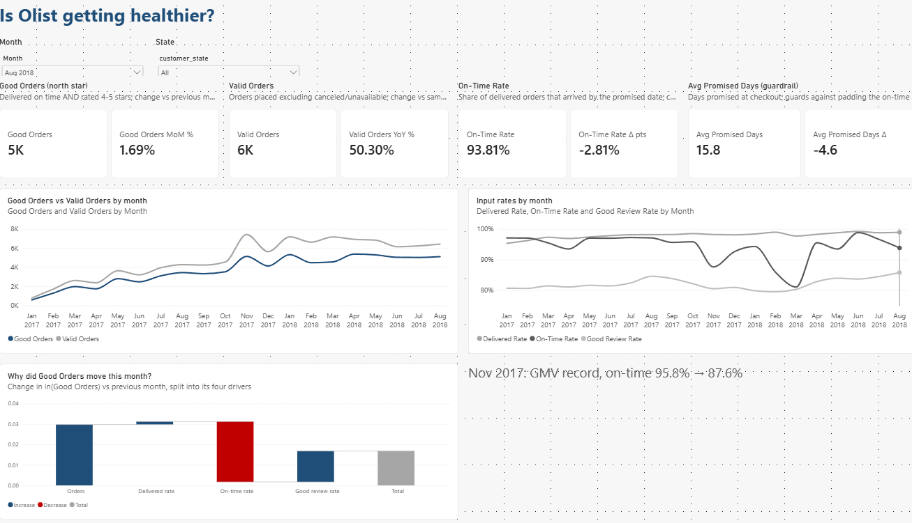
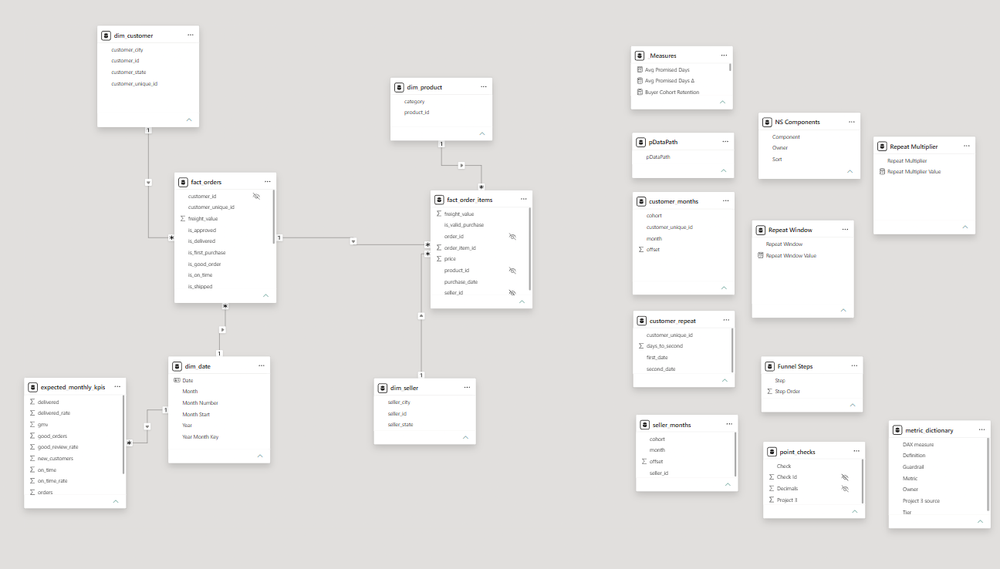
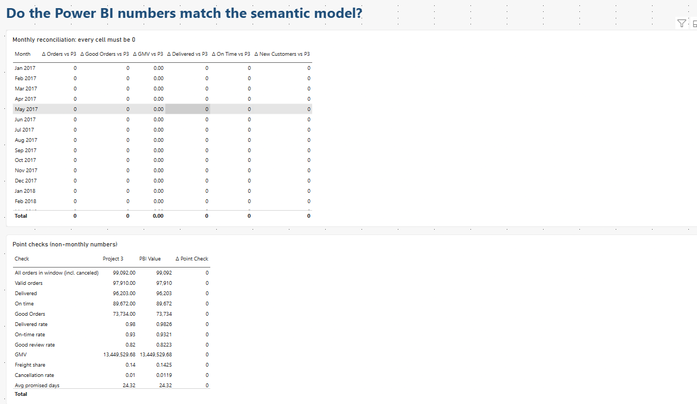

# Olist Business Health: Power BI Metric Layer, Reconciled to Python




> **North star: Good Orders.** This report re-implements the Project 3 metric framework as a Power BI semantic model and proves, order for order, that it produces the same numbers as the Python model.

## Problem & North Star

Olist is a marketplace: a customer only gets value when an order is **delivered on time and the customer is happy with it**. Gross GMV can't see that.

**Good Orders** = valid orders that were delivered on or before the promised date **and** received a 4–5★ review.

Why not GMV? It is a lagging financial outcome and blind to service quality. In Nov 2017 GMV hit a record while on-time delivery fell from 95.8% to 87.6%. GMV stayed on the dashboard, but as a **guardrail**, not the target. Good Orders decomposes cleanly into four levers, each with a different owner:

```
Δ ln(Good Orders) = Δ ln(Orders) + Δ ln(Delivered Rate) + Δ ln(On-Time Rate) + Δ ln(Good Review Rate)
```

That identity powers the waterfall on the Health page ("Why did Good Orders move this month?"). Rejected candidates (GMV, cumulative buyers, raw average review score) and the reasoning are in [`docs/metric_dictionary.csv`](docs/metric_dictionary.csv).

## Data Model



Two fact tables, deliberately kept apart because they have **different grains**:

| Table | Grain | Used for |
|---|---|---|
| `fact_orders` | one row per order | Good Orders, rates, cancellation, delivery promise, retention flags |
| `fact_order_items` | one row per order line | GMV, freight share, product and seller slicing |

`fact_order_items` relates to `fact_orders` through `order_id`, and to `dim_product` and `dim_seller`. `fact_orders` relates to `dim_date` and `dim_customer`. Order-level counts are never computed on the item table, so an order with three items cannot be counted three times.

All measures live in a single `_Measures` table, grouped in display folders: `1 North Star`, `2 Inputs`, `3 Guardrails`, `4 Diagnostics`. The full catalog is in [`docs/dax_measures.md`](docs/dax_measures.md).

## Reconciliation Proof



A report that looks right is not a report that is right. The `Reconciliation` page compares the Power BI measures against the Python semantic model from Project 3, exported to [`reconciliation/expected_monthly_kpis.csv`](reconciliation/export_expected.py) and loaded into the model as a table.

- **Monthly grid:** Orders, Good Orders, GMV, Delivered, On Time and New Customers, for every month (Jan 2017 – Aug 2018). Every cell must be `0`.
- **Point checks:** 12 non-monthly numbers, all with a delta of `0`:

| Check | Python | Power BI |
|---|---|---|
| All orders in window | 99,092 | 99,092 |
| Valid orders | 97,910 | 97,910 |
| Delivered | 96,203 | 96,203 |
| On time | 89,672 | 89,672 |
| **Good Orders** | **73,734** | **73,734** |
| GMV | 13,449,529.68 | 13,449,529.68 |

Counts match order for order, and GMV matches to the cent. Retention diagnostics (buyer and seller M3, repeat rate) also match the Python marts; see the catalog for details.

## Power BI vs. Streamlit/Python

The same metric layer now exists twice, on purpose. Neither tool is "better"; they answer different needs.

| | **Power BI (this repo)** | **Streamlit + Python (Project 3)** |
|---|---|---|
| Audience | Business users who slice, filter and drill on their own | Analysts and engineers who want full control |
| Metric logic | DAX measures in a governed semantic model | SQL/pandas in a versioned code module |
| Interactivity | Cross-filtering, drill-through, bookmarks out of the box | Whatever you code |
| Custom analysis | Limited (no arbitrary statistics) | Unlimited (simulations, causal methods, any library) |
| Testing & review | Possible but awkward (TMDL diffs, manual QA page) | Natural (unit tests, git diffs, CI) |
| Deployment | Power BI Service, row-level security, enterprise sharing | Any Python host, free tiers available |
| Cost of change | Fast for visuals, slow for complex logic | Slow for visuals, fast for complex logic |

**Rule of thumb:** build and validate the metric definitions in Python, where they can be tested; serve them to the business in Power BI, where people can explore them. The reconciliation page is what makes that handoff trustworthy.

## Report Pages

| Page | Business question it answers |
|---|---|
| **Health** | Is Olist getting healthier? Good Orders, Valid Orders, On-Time Rate and the promise guardrail, with a decomposition of the monthly move |
| **Funnel** | Where do orders fail between being placed and becoming a good order? |
| **State Detail** | (drill-through) Which states lose the most good orders, and why? |
| **Retention** | Should Olist invest in retention? Cohort retention plus a what-if on the GMV impact |
| **Metric Dictionary** | What does each metric mean, who owns it, and which guardrail protects it? |
| **Reconciliation** | Do the Power BI numbers match the semantic model? |

## Repository Structure

```
olist_metrics_reports.pbip            # open this in Power BI Desktop
olist_metrics_reports.Report/         # report definition (PBIR)
olist_metrics_reports.SemanticModel/  # semantic model (TMDL: tables, measures, relationships)
docs/                                 # data model, DAX catalog, metric dictionary, PDF export
reconciliation/                       # Python export of expected KPIs
ScreenShots/
```

## Getting Started

1. Open `olist_metrics_reports.pbip` in Power BI Desktop (Developer Mode / PBIP preview features enabled).
2. Set the `pDataPath` parameter to the folder holding the raw Olist CSVs (in Project 3: `data/raw/`).
3. Refresh. The Reconciliation page should show zeros everywhere.

## Limitations

- Seller M3 retention is **53.22%** on the current marts, while the original Project 3 write-up says 49.19%. Power BI matches the current marts, not the older text.
- Buyer M3 retention is tiny (~0.25%): most Olist customers buy once.
- The data covers Jan 2017 – Aug 2018 only.

## Related Project

The Python side of this metric layer, with a live Streamlit dashboard, is in [Project 3: Business Metrics Dashboard](https://github.com/veysellball/business-metrics-dashboard).

## Data & Author

Data: [Olist Brazilian E-Commerce dataset](https://www.kaggle.com/datasets/olistbr/brazilian-ecommerce) (Kaggle, CC BY-NC-SA 4.0).
Author: [veysellball](https://github.com/veysellball)
